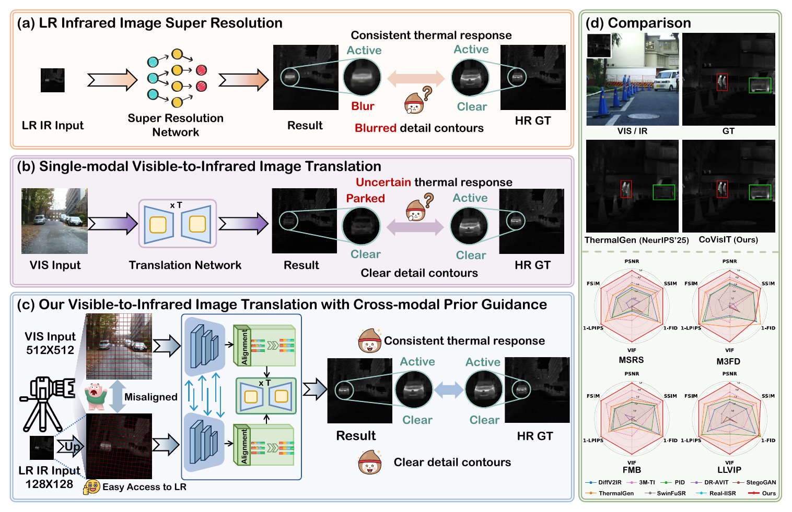
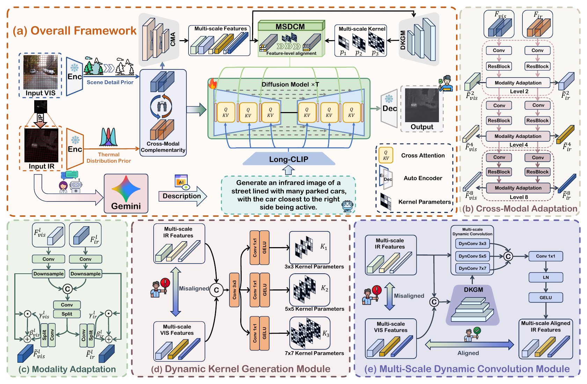
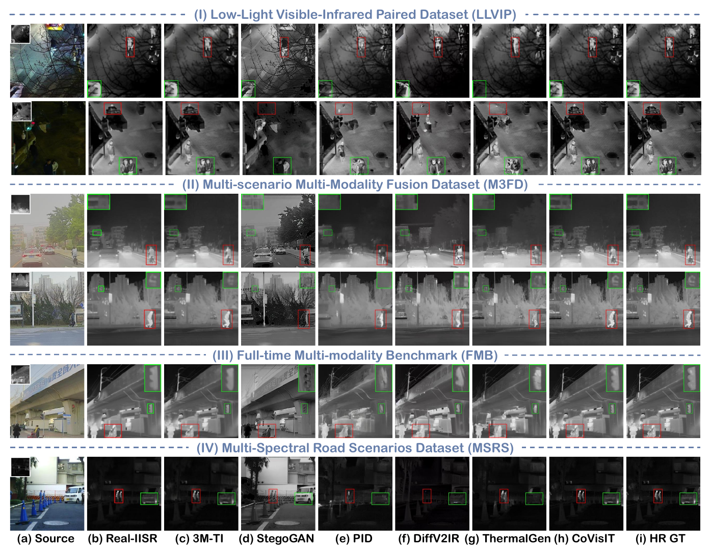
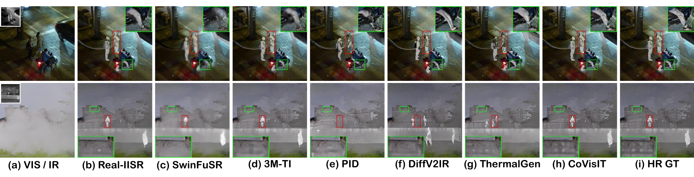
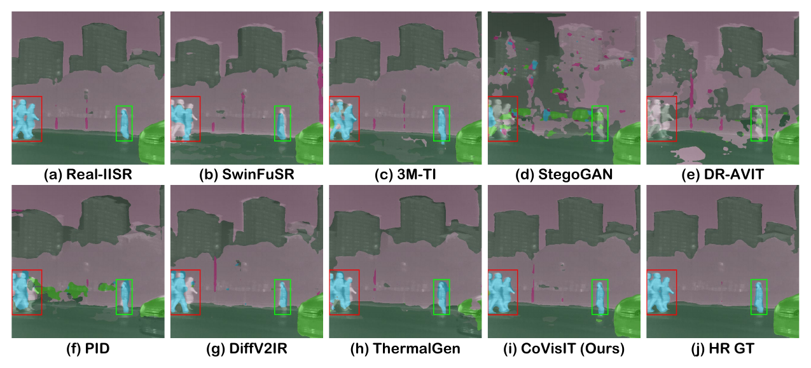
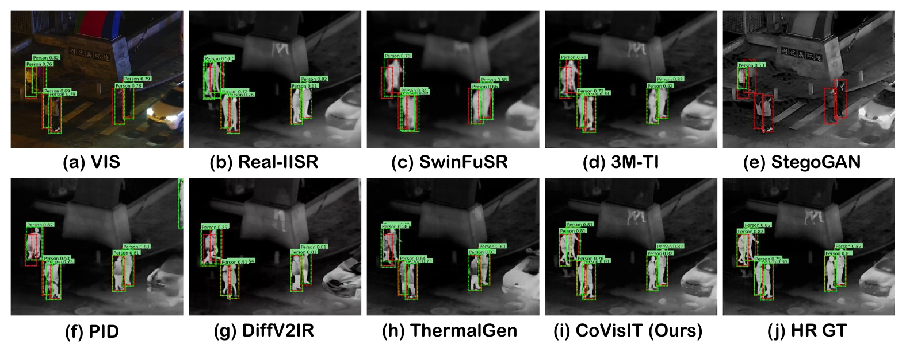

<h1 align="center">CoVisIT: Cross-Modal Prior Guided Diffusion Model for Visible-to-Infrared Image Translation</h1>

<p align="center">
  <a href="https://linfeng-tang.github.io/">Linfeng Tang</a>, Tong Hu, Zizhuo Li, Hao Zhang, Han Xu, Zhenfeng Shao, <a href="https://jiayi-ma.github.io/">Jiayi Ma</a>
</p>

<p align="center"><strong>NeurIPS 2026</strong></p>

<p align="center">
  
  <a href="https://github.com/Linfeng-Tang/CoVisIT/tree/without-text">
    
  </a>
</p>

<p align="center"><strong>High-resolution infrared generation with visible detail priors and low-resolution infrared thermal cues.</strong></p>

> This is the official project repository for CoVisIT. It contains the project overview, paper figures, source code, environment requirements, and training and testing instructions. Pretrained CoVisIT checkpoints are available on Baidu Netdisk; a public paper link is not yet available.

## ✨ News

- **[2026-09-25]** CoVisIT was accepted by **NeurIPS 2026**!

## 🔎 Overview

Visible-to-infrared translation must recover both fine scene structures and reliable thermal responses. Visible images provide detailed structural cues, but do not directly observe thermal radiation. Low-resolution infrared images provide thermal-distribution cues, yet may lack detail and be spatially misaligned with the visible input.

**CoVisIT** combines a high-resolution visible image with a potentially misaligned low-resolution infrared image in a latent diffusion framework. It generates a high-resolution infrared image aligned with the visible input, using visible features for scene details and infrared features for thermal-distribution guidance. Auxiliary scene descriptions extracted from the infrared input provide additional text conditioning.

### Motivation



Unlike visible-only translation, CoVisIT uses observed infrared cues to constrain thermal responses. Unlike infrared super-resolution alone, it also exploits visible scene details and explicitly addresses cross-modal misalignment at the feature level.

## 🧩 Method



The framework contains three main components:

1. **Cross-Modal Adaptation (CMA):** bidirectional feature calibration reduces the visible-infrared representation gap and enables complementary prior extraction.
2. **Dynamic Kernel Generation Module (DKGM):** cross-modal features predict input-adaptive kernels at multiple scales.
3. **Multi-Scale Dynamic Convolution Module (MSDCM):** the generated kernels dynamically aggregate local infrared features for implicit alignment during denoising.

The denoising U-Net is conditioned on visible detail features, aligned infrared thermal features, and text features encoded by Long-CLIP. The training objective combines diffusion, image reconstruction, and thermal-distribution consistency losses.

## 📷 Results

### Infrared Image Generation

The paper evaluates infrared generation on **LLVIP, M3FD, FMB, and MSRS**, using PSNR, SSIM, FSIM, VIF, LPIPS, and FID.



### Downstream Image Fusion

Generated infrared images are fused with their visible counterparts using **EMMA** to evaluate their usefulness for image fusion.



### Semantic Segmentation

The paper trains **SegNeXt** on ground-truth infrared images from **FMB** and evaluates it on generated infrared images.



### Object Detection

The paper trains **YOLOv8** on ground-truth infrared images from **LLVIP** and evaluates it on generated infrared images.



Selected downstream results reported in the paper are shown below. **HR GT** is the real high-resolution infrared reference, not another generation method.

| Task / dataset | Metric | CoVisIT | HR GT reference |
| --- | --- | ---: | ---: |
| Semantic segmentation / FMB | mIoU (%) ↑ | 48.2 | 52.0 |
| Semantic segmentation / FMB | mAcc (%) ↑ | 58.6 | 62.6 |
| Object detection / LLVIP | AP@0.50 ↑ | 0.981 | 0.987 |
| Object detection / LLVIP | mAP@0.5:0.95 ↑ | 0.676 | 0.712 |

**Limitations.** The evaluation uses simulated low-resolution and misaligned infrared inputs; real sensor degradations can be more complex. Diffusion sampling is also slower than feed-forward generation.

## 🗂️ Versions and Repository Structure

**Model without text guidance** — this branch contains the runnable model at the repository root.

- [`main`](https://github.com/Linfeng-Tang/CoVisIT/tree/main): full model with text guidance (default).
- [`without-text`](https://github.com/Linfeng-Tang/CoVisIT/tree/without-text): model without text guidance; no text annotations or Long-CLIP weights required.

```text
CoVisIT/
├── assets/
├── configs/
├── models/
├── pretrained/
├── utils/
├── dataset.py
├── dataset_test.py
├── train.py
├── test.py
└── requirements.txt
```

## 🛠️ Create Environment

### 1. Clone the repository

```bash
git clone --branch without-text https://github.com/Linfeng-Tang/CoVisIT.git
cd CoVisIT
```

### 2. Create a Conda environment

```bash
conda create -n covisit python=3.9 -y
conda activate covisit
```

The experiments use the following software versions:

| Component | Version |
| --- | --- |
| Python | 3.9.0 |
| PyTorch | 2.8.0 |
| Torchvision | 0.23.0 |
| CUDA (PyTorch) | 12.8 |
| cuDNN | 9.10.2 |

### 3. Install dependencies

```bash
pip install torch==2.8.0 torchvision==0.23.0 \
  --index-url https://download.pytorch.org/whl/cu128
```

```bash
pip install -r requirements.txt
```

## 📥 Pre-trained Weights

Download the matching CoVisIT checkpoint from [Baidu Netdisk](https://pan.baidu.com/s/1O8LASlZP2yk-HJUE9yl_pQ?pwd=h24t) (code: `h24t`) into `checkpoints/`. Place autoencoder weights at `pretrained/ae.pth`.

Use the no-text checkpoint `checkpoints/covisit_notext.pth`.

## 🗂️ Dataset Preparation

Each sample contains a visible image, a high-resolution infrared ground-truth image, and a low-resolution or degraded infrared guidance image. Corresponding images should have matching filenames.

### 1. Dataset organization

```text
/path/to/dataset/
├── train/
│   ├── visible/
│   ├── infrared_gt/
│   └── infrared_input/
├── val/
│   ├── visible/
│   ├── infrared_gt/
│   └── infrared_input/
├── test/
│   ├── visible/
│   ├── infrared_gt/
│   └── infrared_input/
└── text/
    ├── train.jsonl
    ├── val.jsonl
    └── test.jsonl
```

### 2. Configure the dataset directories

Set the dataset paths and folder names in `configs/config.yml`:

```yaml
data:
  trainpath: '/path/to/dataset/train'
  valpath: '/path/to/dataset/val'
  testpath: '/path/to/dataset/test'

  train_raw_dir: 'visible'
  train_gt_dir: 'infrared_gt'
  train_guide_dir: 'infrared_input'

  val_raw_dir: 'visible'
  val_gt_dir: 'infrared_gt'
  val_guide_dir: 'infrared_input'

  test_raw_dir: 'visible'
  test_gt_dir: 'infrared_gt'
  test_guide_dir: 'infrared_input'
```

Text annotations are not required on this branch.

## 🔥 Training

Configure dataset paths, pretrained weights, and training settings in the relevant `configs/config.yml` before training.


From the repository root:

```bash
CUDA_VISIBLE_DEVICES=0 python train.py --config configs/config.yml
```

## 🧪 Testing

Test dataset paths and folder names are loaded from the `data.testpath`, `data.test_raw_dir`, `data.test_gt_dir`, and `data.test_guide_dir` settings in the corresponding YAML file. This version does not use text conditioning.


From the repository root:

```bash
CUDA_VISIBLE_DEVICES=0 python test.py \
  --config configs/config.yml \
  --ckpt_path checkpoints/covisit_notext.pth \
  --sampling_timesteps 50 \
  --batch_size 1 \
  --save_dir test_results
```

```text
test_results/
├── generated_images/
│   └── rank0/
└── metrics.txt
```

## 📦 Release Status

- [x] Project overview and figures
- [ ] Public paper link
- [x] Source code and environment requirements
- [x] Pretrained models
- [x] Training, inference, and evaluation instructions

Source code and installation, training, inference, and evaluation instructions are available in this repository. Pretrained CoVisIT checkpoints for both versions are available through the Baidu Netdisk link above.

## 🎓 Citation

If this work is useful for your research, please consider citing:

```bibtex
@inproceedings{Tang2026CoVisIT,
  title={CoVisIT: Cross-Modal Prior Guided Diffusion Model for Visible-to-Infrared Image Translation},
  author={Tang, Linfeng and Hu, Tong and Li, Zizhuo and Zhang, Hao and Xu, Han and Shao, Zhenfeng and Ma, Jiayi},
  booktitle={Advances in Neural Information Processing Systems (NeurIPS)},
  year={2026}
}
```

## 🤝 Contact

For questions and academic discussions, please contact **Linfeng Tang** at [linfeng0419@gmail.com](mailto:linfeng0419@gmail.com).
